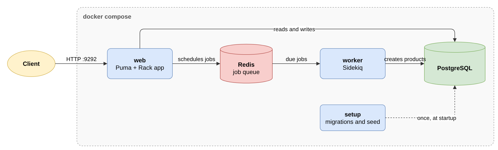
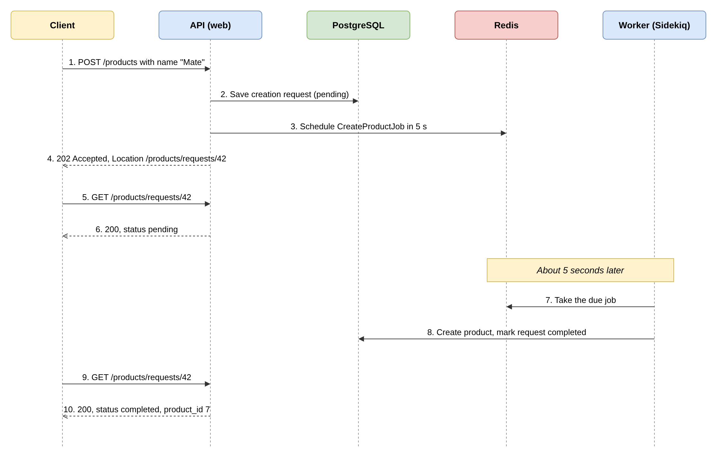
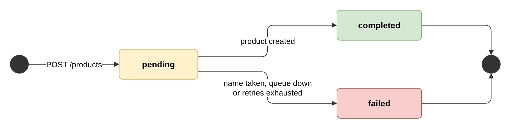

# Fudo Challenge — Products API

A RESTful API built on plain [Rack](https://github.com/rack/rack) that lets users:

- **log in** with a username and password, stored hashed with bcrypt, to get a JWT
- **request the creation of products**, which happens **asynchronously** in a [Sidekiq](https://sidekiq.org) job queue, so a product becomes available **5 seconds** after it is requested
- **list their own products**, paginated
- get a static **`AUTHORS`** file that can be cached for 24 hours

Responses are gzip-compressed whenever the client asks for it.

- [Architecture](#architecture)
- [Quick start](#quick-start)
- [Try it](#try-it)
- [API reference](#api-reference)
- [Local development](#local-development)
- [Configuration](#configuration)
- [Project structure](#project-structure)
- [Design decisions](#design-decisions)
- [Trade-offs and next steps](#trade-offs-and-next-steps)

## Architecture

The API (`web`) never creates products itself. It saves each creation request in PostgreSQL and schedules a job in Redis, and a separate Sidekiq process (`worker`) runs that job 5 seconds later.



## Quick start

The only requirement is [Docker](https://docs.docker.com/get-docker/) with Docker Compose.

```bash
git clone https://github.com/MaribelClaros/fudo-challenge.git
cd fudo-challenge
docker compose up --build
```

This starts five containers, in order:

| Container | What it does |
|---|---|
| `postgres`, `redis` | The database and the job queue's storage. |
| `setup` | Runs the migrations and creates a demo user, then exits. |
| `web` | The API, on **http://localhost:9292**. |
| `worker` | The Sidekiq process that creates the products. |

It is ready when `web` logs `Listening on http://0.0.0.0:9292`.

**Demo user:** `demo` / `demo-password`.

To stop it, press `Ctrl+C` or run `docker compose down` (add `-v` to also delete the data).

> The containers use a development-only `JWT_SECRET`. To use your own, export `JWT_SECRET` (at least 32 characters) before `docker compose up`.

## Try it

### With Postman

1. Import [`docs/postman/fudo-challenge.postman_collection.json`](docs/postman/fudo-challenge.postman_collection.json).
2. Run **Auth → Log in**. The token is saved in a collection variable and sent by every other request.
3. Run **Products → Create product** (`202 Accepted`), then **Get creation status**, which shows `pending` at first and `completed` about 5 seconds later.
4. Run **List products** to see the new product.

Running the whole collection (**Run collection**) checks every endpoint, including some error cases.

### With curl

```bash
# 1. Log in
TOKEN=$(curl -s -X POST localhost:9292/auth \
  -H 'Content-Type: application/json' \
  -d '{"username":"demo","password":"demo-password"}' \
  | ruby -rjson -e 'puts JSON.parse($stdin.read)["access_token"]')

# 2. Request a product: 202 Accepted, with a Location header to follow it
curl -i -X POST localhost:9292/products \
  -H "Authorization: Bearer $TOKEN" -H 'Content-Type: application/json' \
  -d '{"name":"Mate"}'

# 3. Follow the request (use the id from the Location header): pending, then completed
curl -s localhost:9292/products/requests/<id> -H "Authorization: Bearer $TOKEN"

# 4. After ~5 seconds, the product is listed
curl -s localhost:9292/products -H "Authorization: Bearer $TOKEN"

# 5. The AUTHORS file, cacheable for 24 hours
curl -i localhost:9292/AUTHORS

# Compressed responses: add Accept-Encoding (--compressed lets curl decompress them)
curl -s --compressed -D - -o /dev/null localhost:9292/products \
  -H "Authorization: Bearer $TOKEN" -H 'Accept-Encoding: gzip'
```

> Right after the worker starts, Sidekiq waits a few seconds before checking for scheduled jobs, so the very first product can take ~10 seconds. The following ones take ~5.

## API reference

The full reference, with every request, response and error, is in **[`docs/openapi.yaml`](docs/openapi.yaml)** (OpenAPI 3.1). To read it rendered:

- paste it into [editor.swagger.io](https://editor.swagger.io) or import it into Postman
- build a static page with `npx @redocly/cli build-docs docs/openapi.yaml -o api-docs.html`

| Method | Path | Auth | Description |
|---|---|---|---|
| `POST` | `/auth` | — | Exchanges username and password for an access token (JWT, valid for 1 hour). |
| `POST` | `/products` | Bearer | Requests a product creation. `202` while pending, `200` if the product already exists. |
| `GET` | `/products/requests/:id` | Bearer | Status of a creation request: `pending`, `completed` or `failed`. |
| `GET` | `/products` | Bearer | The user's products, oldest first. `?limit=` (default 20, max 100) and `?after=<next_cursor>`. |
| `GET` | `/AUTHORS` | — | Static file, `Cache-Control: public, max-age=86400`. |
| `GET` | `/health` | — | `200` if the API and its database are up, `503` otherwise. |

Errors are JSON, with a machine-readable code and, for validation errors, the invalid fields:

```json
{"error": "invalid_params", "details": {"name": "must be a non-empty string of at most 255 characters"}}
```

## Local development

To run the app and the tests on your machine, you need **Ruby 3.4.12**, the version in [`.ruby-version`](.ruby-version) (with [rbenv](https://github.com/rbenv/rbenv), `rbenv install` installs it), and Docker for PostgreSQL and Redis.

```bash
cp .env.example .env                     # then set JWT_SECRET, generated with ruby -rsecurerandom -e 'puts SecureRandom.hex(32)'
bundle install
docker compose up -d postgres redis      # only the databases

bundle exec rake db:migrate              # development database
RACK_ENV=test bundle exec rake db:migrate
bundle exec rake db:seed                 # demo user

bundle exec puma                         # the API, on http://localhost:9292
bundle exec sidekiq -r ./config/worker.rb   # the worker, in another terminal
bin/console                              # an IRB console with the app loaded
```

The test database (`fudo_test`) is created the first time the Postgres container starts. If your Postgres volume already existed, create it once with `docker compose exec postgres createdb -U fudo fudo_test`.

### Tests and linting

```bash
bundle exec rspec      # the test suite
bundle exec rubocop    # style and lint
```

The tests run against a real PostgreSQL database. Each example runs inside a transaction that is rolled back, so they never see each other's data. Sidekiq runs in fake mode, which keeps jobs in memory so the specs can run them explicitly. [GitHub Actions](.github/workflows/ci.yml) runs both on every push.

## Configuration

Everything is configured through environment variables. The app refuses to start if a required one is missing.

| Variable | Required | Default | Description |
|---|---|---|---|
| `DATABASE_URL` | yes | — | PostgreSQL connection URL. |
| `TEST_DATABASE_URL` | for tests | — | Used instead of `DATABASE_URL` when `RACK_ENV=test`. |
| `REDIS_URL` | yes | — | Redis URL for the Sidekiq job queue. |
| `JWT_SECRET` | yes | — | Key that signs the access tokens. At least 32 characters. |
| `JWT_TTL_SECONDS` | no | `3600` | Access token lifetime. |
| `RACK_ENV` | no | `development` | `development`, `test` or `production`. Outside production, `.env` is loaded. |
| `DB_POOL` | no | `5` | Database connections per process. Keep it ≥ `PUMA_THREADS` and ≥ Sidekiq's concurrency (5). |
| `PUMA_THREADS` | no | `5` | Requests served concurrently by each Puma process. |
| `WEB_CONCURRENCY` | no | `0` | Puma worker processes (0 = single process). |
| `PORT` | no | `9292` | HTTP port. |
| `SEED_USERNAME`, `SEED_PASSWORD` | no | `demo`, `demo-password` | Demo user created by `rake db:seed`. |

## Project structure

```
config.ru                 Rack entry point
config/
  boot.rb                 loads settings, database and queue
  settings.rb             environment variables, validated at boot
  database.rb, queue.rb   PostgreSQL (Sequel) and Sidekiq connections
  puma.rb, worker.rb      web server and worker process
db/
  migrations/             schema
  seeds.rb                demo user
lib/
  app.rb                  middleware stack and routes
  router.rb               minimal router: path params, 404 and 405
  middleware/             authentication (JWT) and error handling
  controllers/            one module per resource
  services/               authentication, tokens and product creation logic
  jobs/                   CreateProductJob (Sidekiq)
  models/                 Sequel models
  pagination.rb, json_body.rb, json_response.rb, http_error.rb
spec/                     RSpec suite (request, unit and job specs)
docs/                     OpenAPI reference and Postman collection
```

## Design decisions

### No framework, on purpose

As the challenge requires, there is no web framework. The app is a stack of Rack middlewares around a small router written for this project, and every request goes through them in this order:

```
Rack::Deflater → ErrorHandler → Rack::ConditionalGet → Authentication → Router → controller
```

- **`Rack::Deflater`** (outermost) compresses everything, error responses included.
- **`ErrorHandler`** turns errors into JSON responses. Expected ones (`HttpError`, raised anywhere with a status and a code) keep their status. Anything else becomes a generic `500` and is logged, so internal details never reach the client.
- **`Rack::ConditionalGet`** answers `304 Not Modified` when a cached copy is still valid.
- **`Authentication`** requires a valid token on every non-public path.
- **The router** matches by method and path, extracts parameters like `/products/requests/:id`, and distinguishes `404` (unknown path) from `405` (known path, wrong method, with an `Allow` header).

The app is built in one place (`App.build`), so the test suite exercises exactly the stack that runs in production.

### Authentication

- **Passwords** are stored as bcrypt hashes only.
- **Login takes the same time whether the user exists or not.** When the username is unknown, the password is still compared against a dummy bcrypt hash. Both failures return the same `401` with the same body. Otherwise, response times or messages would reveal which usernames exist.
- **Tokens** are JWTs signed with HS256. Verification pins the algorithm (which rules out `alg: none` tokens) and requires the `sub` and `exp` claims, so a token without an expiration is rejected. The secret comes from the environment and must be at least 32 characters, or the app doesn't start. The response carries `Cache-Control: no-store`.
- **Unknown paths need a token too**, so without one they return `401` instead of `404`, and the API can't be probed anonymously for its routes.
- **Authorization is built into the queries.** Every query is scoped to the authenticated user. Another user's resource is reported as `404`, not `403`, so it isn't even confirmed to exist.

### Asynchronous product creation

`POST /products` doesn't create the product. It records a **creation request** (`product_requests` table), schedules `CreateProductJob` in Sidekiq to run 5 seconds later, and answers `202 Accepted` with a `Location` header pointing to the request and `Retry-After: 5`. The client follows the request until it is `completed` or `failed`. Keeping the request in the database means its status survives restarts and can be queried by the client.



A creation request moves through these states, and never goes back to `pending`:



- **Sidekiq and Redis** were chosen because Sidekiq is the standard job queue in Ruby, and it provides scheduled jobs (`perform_in`), retries with backoff and a dead set out of the box. Its scheduler is set to check for due jobs every second (instead of ~5), so products appear 5–6 seconds after they are requested rather than up to 10.
- **Enqueued after the request is saved**, so the job always finds it. If Redis is down, the request is marked `failed` (`queue_unavailable`) and the API answers `503`, instead of leaving it pending forever.

### Idempotency

**Requests are idempotent by name.** A user can't have two products with the same name (the challenge's rule), so asking for the same name again is, by definition, the same request:

| When `POST /products` arrives… | Response |
|---|---|
| New name | `202` with a new pending request |
| A request for that name is already pending | `202` with **the same** request |
| The product already exists | `200` with the completed request that created it |
| The previous request for that name failed | `202` with a new request |

Names are compared **case-insensitively**, and the name is stored as first written. A client can retry any number of times, for example after a network error, and there will still be one product. Two identical requests arriving at the same time are resolved by the database. A partial unique index allows only one pending request per name, and the request that loses the race returns the winner's.

**The job is idempotent too.** Sidekiq guarantees at-least-once delivery, so a job may run twice. The job locks the request row (`SELECT … FOR UPDATE`) and only acts while it is `pending`. `pending → completed | failed` is a one-way state machine, and no code moves a request back to `pending`. As a second, independent guard, a unique index on `(user_id, lower(name))` makes a duplicate product impossible. If the product insert hits that index, a savepoint lets the transaction record the failure (`name_taken`). If every retry fails, the request is marked `processing_failed`.

### Data integrity in the database

Rules that must always hold are enforced by PostgreSQL rather than only in Ruby: foreign keys, unique indexes (usernames, product names per user, one pending request per name) and a check constraint on the request status. They hold even with concurrent requests, where checks in application code alone have race conditions.

### Pagination

`GET /products` uses **cursor (keyset) pagination**, with the query `WHERE id > :after ORDER BY id LIMIT :limit` served by an index on `(user_id, id)`. Unlike `OFFSET`, the cost of a page doesn't grow with how deep it is. One extra row is fetched to know whether there is a next page, which avoids a `COUNT` query. Default page size is 20, maximum 100.

### Caching `/AUTHORS`

`Cache-Control: public, max-age=86400` lets clients and shared caches keep it for 24 hours. It also carries an `ETag` and `Last-Modified`, so after those 24 hours a client can revalidate with `If-None-Match` and get an empty `304` instead of the whole file.

### Production readiness

- Configuration through environment variables, validated at boot (fail fast).
- A multi-stage Docker image, with no compilers in the final image, that runs as a non-root user.
- A `setup` container runs the migrations once, before the web and worker containers start, so several instances never migrate at the same time.
- A health check endpoint that checks the database, used by Docker.
- The database connection pool is sized to the number of threads.
- Request bodies are limited to 16 KB.

## Trade-offs and next steps

- **Enqueueing is not transactional.** The request is saved in PostgreSQL and the job in Redis, two different systems. Redis being down is handled, but if the API process died right between both writes, that request would stay `pending`. The next step would be a periodic *sweeper* job that re-enqueues requests pending for more than a minute. Other options are a PostgreSQL-backed queue (such as `que`, where the job is inserted in the same transaction) or the outbox pattern.
- **Redis durability.** In production, enable AOF persistence or use a managed Redis, so a restart doesn't lose scheduled jobs. The sweeper would also cover this case.
- **Rate limiting** on `/auth` against brute force (for example `rack-attack` backed by Redis).
- **Token lifecycle.** Add refresh tokens and revocation, since today a token is valid until it expires.
- **Observability**, with structured logs, request ids, metrics and Sidekiq's web UI.
- **Health check** that also reports on Redis.
- **Deploying to AWS.** The app is containerized and configured through environment variables, so it maps directly to managed services. `web` and `worker` would run as two Amazon ECS services from the same image, stored in Amazon ECR, with `web` behind an Application Load Balancer that uses `/health` as its health check. The migrations would run as a one-off ECS task on each deploy. PostgreSQL would move to Amazon RDS and Redis to Amazon ElastiCache, and secrets such as `JWT_SECRET` would come from AWS Secrets Manager. The infrastructure would be defined as code with Terraform or AWS CDK, and the existing GitHub Actions workflow would build the image, push it to ECR and deploy it after the tests pass. Amazon SQS, which supports delayed messages natively, could replace Sidekiq and Redis, at the cost of rewriting the worker and losing Sidekiq's built-in retries.
- **Usernames are case-sensitive**, while product names are not. Both choices are explicit, but worth aligning with the product's needs.

## Author

Maribel Katherine Claros (see [`AUTHORS`](AUTHORS)).
